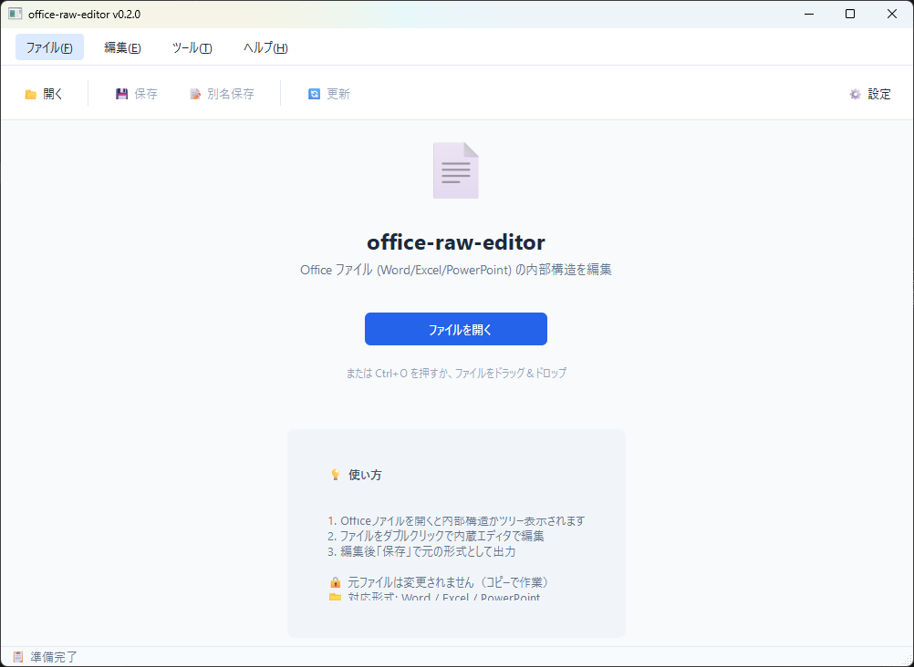
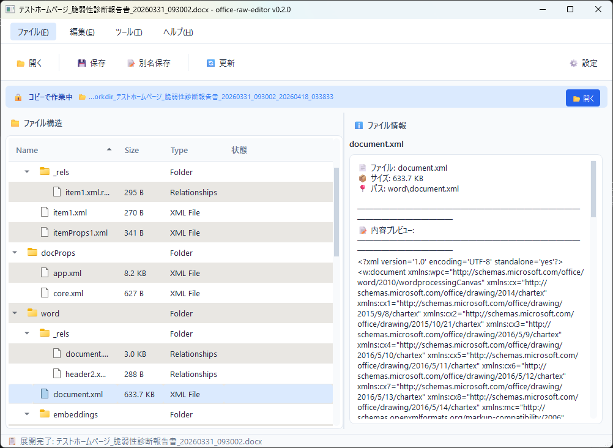
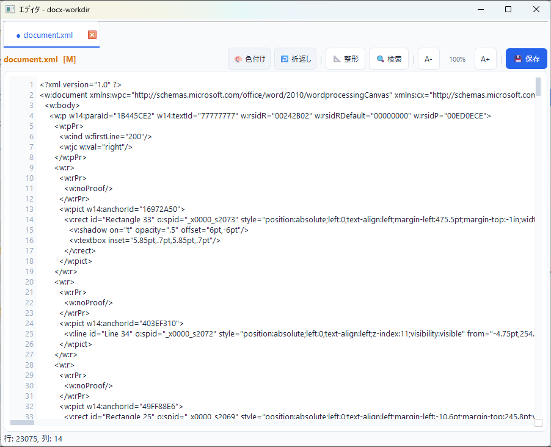

# office-raw-editor

Office Open XML ファイル (`.docx` / `.xlsx` / `.pptx` など) を **ZIP + XML のまま** 直接編集するための、Windows 向けローカル GUI ツール。

ネットワーク通信なし・外部サービス非依存。元ファイルは自動バックアップしつつ常にコピー上で作業するため、壊しても安全。

<p align="center">
  
</p>

<p align="center">
  
  
</p>

## 特徴

- Office ファイルを展開 → ツリー表示 → 再パッケージまで一貫して GUI で完結
- 内蔵 XML エディタ（シンタックスハイライト / 検索 / 整形 / 折返し / フォント拡縮）
- 外部エディタ連携（VS Code / Notepad++ / サクラエディタ などを自動検出）
- 変更ファイルをツリー上でマーキング（`M` 変更 / `A` 追加 / `D` 削除）
- 作業前の自動バックアップ（`.backup`）
- ドラッグ＆ドロップ、画像ファイルのプレビュー
- ネットワーク通信なし、マクロ実行なし

## 対応形式

| 種類 | 拡張子 |
|------|--------|
| Word | `.docx` `.docm` `.dotx` `.dotm` |
| Excel | `.xlsx` `.xlsm` `.xltx` `.xltm` |
| PowerPoint | `.pptx` `.pptm` `.potx` `.potm` `.ppsx` `.ppsm` |

## 技術スタック

- **言語**: Python 3.10+
- **GUI**: [PyQt6](https://pypi.org/project/PyQt6/) 6.5+
- **テスト**: pytest / pytest-qt
- **対象 OS**: Windows 11 / 10（macOS / Linux でも起動可）

## インストール

```bash
# 1. クローン
git clone https://github.com/kuronekorou39/office-raw-editor.git
cd office-raw-editor

# 2. 仮想環境を作成・有効化
python -m venv venv
venv\Scripts\activate          # Windows (cmd)
# .\venv\Scripts\Activate.ps1  # PowerShell

# 3. 依存インストール
pip install -r requirements.txt
pip install -e .

# 4. 起動
python -m docx_workdir
# ファイルを指定して開く:
python -m docx_workdir path\to\file.docx
```

## 使い方

1. **開く** — ツールバーの「開く」、`Ctrl+O`、またはドラッグ＆ドロップ
2. **編集** — ツリー上のファイルをダブルクリック → 内蔵 / 外部エディタを選択
3. **保存** — ツールバーの「保存」or「別名保存」で元形式に再パッケージ

## ショートカット

| キー | 機能 |
|------|------|
| `Ctrl+O` | ファイルを開く |
| `Ctrl+S` | 上書き保存 |
| `Ctrl+Shift+S` | 名前を付けて保存 |
| `Ctrl+F` | エディタ内検索 |
| `F3` / `Shift+F3` | 次 / 前を検索 |
| `Ctrl++` / `Ctrl+-` | フォント拡大 / 縮小 |
| `Ctrl+0` | フォントサイズリセット |
| `F5` | ツリー更新 |

## 仕様・設計方針

詳細は [仕様書.md](./仕様書.md) を参照。要点：

- Office ファイルは単なる ZIP として扱い、XML の意味解釈・修復・最適化は行わない
- 編集は作業ディレクトリ上のコピーに対して行い、明示操作でのみ再パッケージ
- ネットワーク通信・外部 API 呼び出しなし

## 注意

- XML 構造を壊すと Office アプリで開けなくなる場合があります（バックアップから復元してください）
- 大きな XML は内蔵エディタの **色付け OFF** で軽快になります

## ライセンス

MIT License
